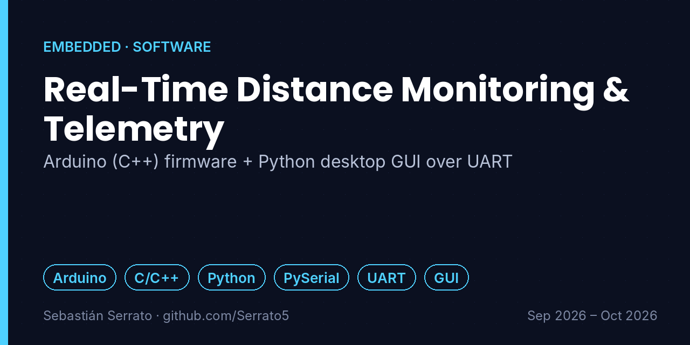
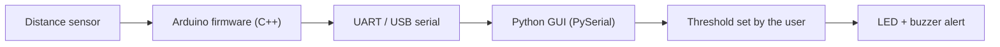

# Real-Time Distance Monitoring & Telemetry

**Arduino (C++) firmware + Python desktop GUI over UART**

`Arduino` `C/C++` `Python` `PySerial` `UART` `GUI`

## Overview

A complete hardware–software solution that reads a distance sensor with C++ firmware on an Arduino and streams the measurements to a Python desktop application, where the user watches the distance in real time and sets a safety threshold.

## Key features

- **Hardware–software integration:** Sensor reading in C++ firmware connected to a Python desktop application.
- **Serial communication protocol:** Bidirectional point-to-point UART channel for continuous telemetry without frame loss.
- **Graphical user interface:** Interactive Python GUI that displays the distance in real time and lets the user define a custom safety threshold on the fly.
- **Actuators and alert logic:** Dual physical response (LED + buzzer) that activates automatically when the measured distance crosses the critical threshold.

## How it works

## What I learned

- Designing a simple, robust serial protocol between a microcontroller and a PC.
- Keeping a GUI responsive while reading a serial port continuously.
- Closing the loop: user input on the PC changes physical behavior on the board.

## Project context

| | |
|---|---|
| Context | Universidad Surcolombiana |
| Dates | Sep 2026 – Oct 2026 |
| Area | Embedded · Software |

## Resumen en español

Sistema que mide distancia con un sensor y firmware en C++ sobre Arduino, envía los datos por UART a una aplicación de escritorio en Python con interfaz gráfica, y activa un LED y un buzzer cuando la distancia supera el umbral que define el usuario.

---

**About this repository:** the original source code and design files of this project were not preserved. This repository documents what was built, how it works and what I learned, based on my project records. It does not contain reconstructed code.

**Sobre este repositorio:** el código y los archivos originales de este proyecto no se conservaron. Aquí se documenta qué se construyó, cómo funciona y qué aprendí, sin código reconstruido.

**Author:** Sebastián Serrato Ramírez · Electronic Engineering student, Universidad Surcolombiana (Neiva, Colombia) · [LinkedIn](https://www.linkedin.com/in/sebaserrato) · [More projects](https://github.com/Serrato5)
